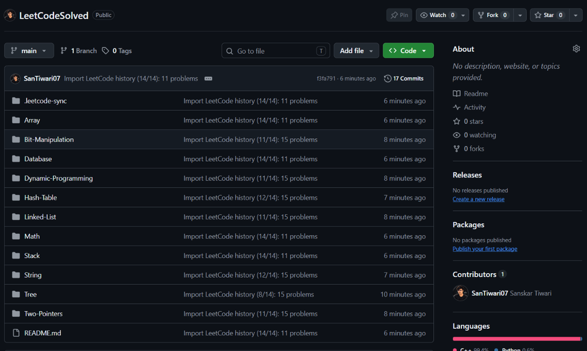
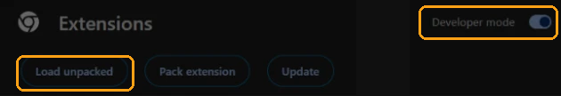
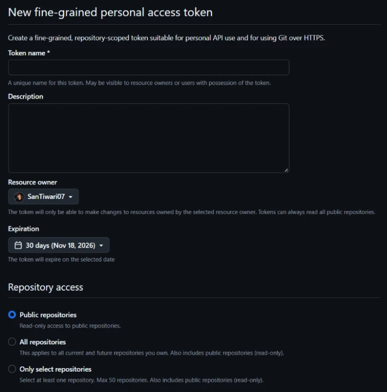
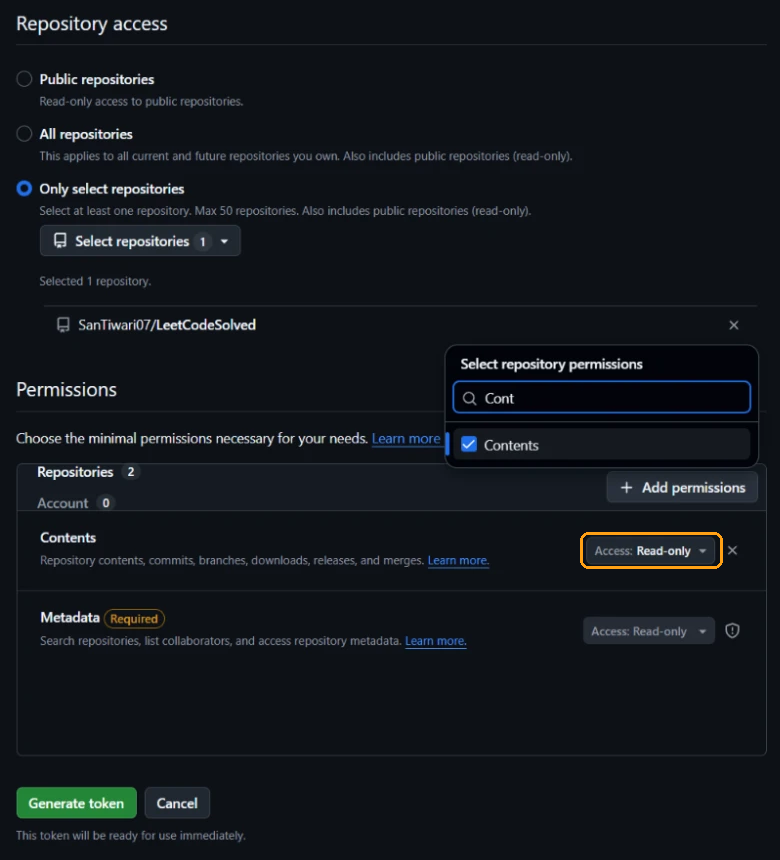
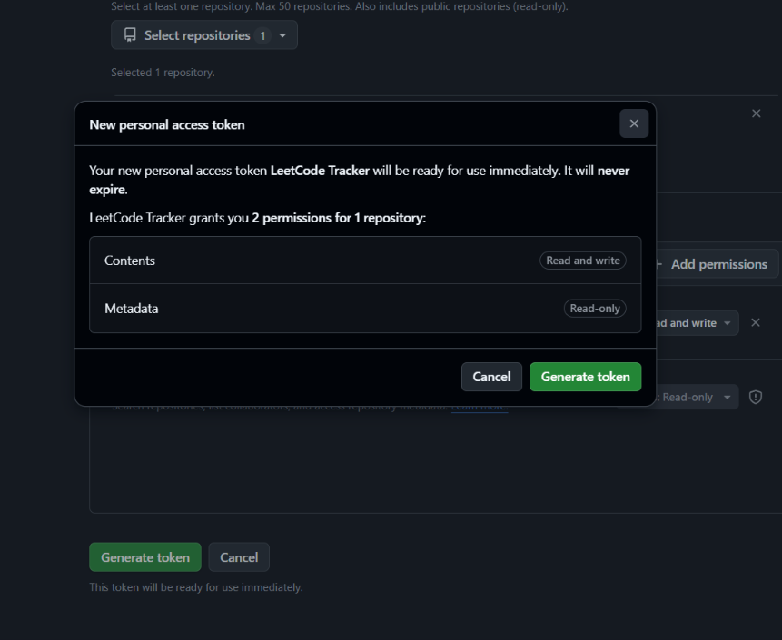
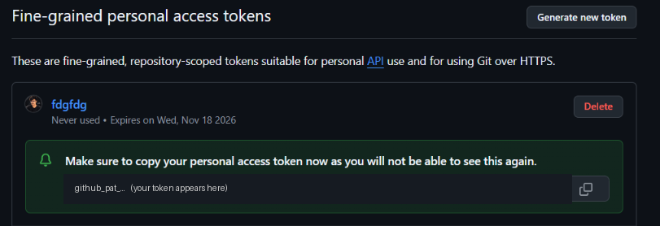
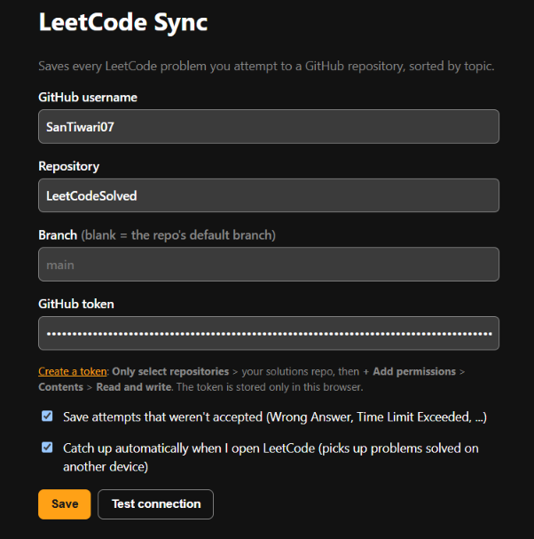

<p align="center">
  
</p>

<h1 align="center">LeetCode Tracker</h1>

<p align="center">
  A Chrome extension that saves every LeetCode problem you attempt to your own GitHub repo,<br>
  sorted by topic, so you always know what you've solved, what's left, and when you did it.
</p>

<p align="center">
  <a href="https://github.com/SanTiwari07/LeetCodeTracker/archive/refs/heads/main.zip">
    
  </a>
</p>

- **Every submission is saved**, Accepted or not, the moment LeetCode judges it.
- **One-click import** of your whole LeetCode history, including your code.
- **Sorted by topic:** each problem goes in a folder for its main topic (Array, String,
  Dynamic Programming, ...). SQL problems go in **Database**.
- **A dashboard README** with your totals, problems you haven't solved yet, recent activity and
  progress by month.
- **No server, no cookies to copy.** The extension runs inside your logged-in LeetCode tab and
  talks only to leetcode.com and the GitHub API.

## What you get

A repo like [SanTiwari07/LeetCodeSolved](https://github.com/SanTiwari07/LeetCodeSolved), filled
in automatically:

<p align="center">
  
</p>

```
README.md                      dashboard: totals, topics, not solved yet, activity, all problems
Array/
  README.md                    every Array problem, plus ones that also use Array
  0001-two-sum/
    README.md                  status, dates, your code per language, submission history, description
    solution.cpp
Database/                      SQL problems
  0183-customers-who-never-order/
    solution.sql
.leetcode-sync/state.json      data the READMEs are built from (don't edit by hand)
```

---

## Setup (about 5 minutes)

### Step 1. Create a repo for your solutions

On GitHub, [create a new repository](https://github.com/new), for example `LeetCodeSolved`. It
can be public or private, and it can be completely empty.

### Step 2. Install the extension

Works in Chrome, Edge, Brave and other Chromium browsers.

1. **Download** this repo with the button at the top of this page
   ([Download ZIP](https://github.com/SanTiwari07/LeetCodeTracker/archive/refs/heads/main.zip)),
   then unzip it. Or, if you use git:

   ```bash
   git clone https://github.com/SanTiwari07/LeetCodeTracker.git
   ```

2. Open `chrome://extensions` in a new tab.
3. Turn on **Developer mode** (top right), then click **Load unpacked** (top left):

   

4. Select the **`extension`** folder inside the download.

   > Pick `LeetCodeTracker-main/extension`, not the outer `LeetCodeTracker-main` folder.
   > Choosing the outer folder gives the error "Manifest file is missing or unreadable".

5. Click the puzzle-piece icon in Chrome's toolbar and pin **LeetCode Tracker** so it's easy to reach.

### Step 3. Make a GitHub token

The token lets the extension save files to your solutions repo, and nothing else.

1. Open [github.com/settings/personal-access-tokens/new](https://github.com/settings/personal-access-tokens/new).
2. **Token name:** anything, for example `LeetCode Tracker`.
3. **Expiration:** pick one. "No expiration" is easiest; with a date, you'll make a new token
   when it runs out.
4. **Repository access:** choose **Only select repositories**.

   

5. Open **Select repositories** and pick your solutions repo (for example `LeetCodeSolved`).
6. **Permissions:** click **+ Add permissions**, type `Contents` and tick it. Then, next to
   **Contents**, change **Access: Read-only** to **Read and write** (the box highlighted below).
   GitHub adds **Metadata: Read-only** on its own; leave it.

   

   Don't add any other permissions. The extension doesn't need them.

7. Click **Generate token**. A box pops up to confirm. It should show exactly **Contents: Read
   and write** and **Metadata: Read-only**:

   

   If it does, click **Generate token** in the box.
8. **Copy the token now** with the copy button. GitHub shows it only once; if you lose it, just
   make a new one.

   

Keep the token private: paste it only into the extension, never into chats, screenshots or code.

### Step 4. Connect the extension

Click the extension icon > **Settings** and fill in:

| Field | What to enter |
|---|---|
| GitHub username | your GitHub username, for example `SanTiwari07` |
| Repository | your solutions repo, for example `LeetCodeSolved` |
| Branch | leave blank |
| GitHub token | the token you just copied |



Click **Save**, then **Test connection**. You should see "Connected to ...".

### Step 5. Import your history

Log in to [leetcode.com](https://leetcode.com), then click the extension icon > **Import full
history**. A progress message appears in the bottom-right corner of the LeetCode page. A few
hundred submissions take about 5 to 10 minutes; keep the tab open until it says it's done.

You're all set.

---

## Daily use

There's nothing to do. Solve problems as usual:

- When LeetCode judges a submission, a message in the corner says **Saved to GitHub**. Click it to
  see the commit.
- Accepted code always wins: a later Wrong Answer in the same language is recorded in the history
  but doesn't replace your working solution.
- Solved something on your phone or another computer? The next time you open LeetCode here, the
  extension catches up on its own. You can also click **Sync now** in the popup.
- Nothing is ever saved twice. Syncing again, or clicking **Import full history** again, only adds
  what's new.

The popup shows your recent saves. If one failed (for example, you were offline), click **Retry**.

## Settings

| Setting | What it does |
|---|---|
| Save attempts that weren't accepted | On by default. Turn off to save only Accepted submissions. |
| Catch up automatically when I open LeetCode | On by default. Checks for missed submissions at most every 30 minutes. |
| Branch | Leave blank to use the repo's default branch. |

## Updating the extension

Download the new version (or `git pull`), then go to `chrome://extensions` and click the reload
icon on **LeetCode Tracker**. Your settings are kept.

## Troubleshooting

| Problem | Fix |
|---|---|
| "Manifest file is missing or unreadable" | You picked the wrong folder. Select the `extension` folder. |
| **Test connection** fails with 401 | The token is wrong or expired. Make a new one. |
| **Test connection** fails with 403 | The token can't write to the repo. Check it has **Contents: Read and write** for that repo. |
| **Test connection** fails with 404 | Check the username and repo name, and that the token has access to that repo. |
| Nothing happens after submitting | Reload the LeetCode tab (tabs opened before installing don't have the extension yet). |
| "Log in to LeetCode, then sync again" | Log in on leetcode.com in this browser, then click **Sync now**. |
| Import stopped halfway | Click **Import full history** again. It skips everything already saved. |
| Where are my SQL solutions? | In the **Database** folder; that's what LeetCode calls its SQL problems. |

## Privacy

Your GitHub token is stored only in this browser's extension storage. The extension talks only to
`leetcode.com` (to read your own submissions) and `api.github.com` (to save them to your repo).
